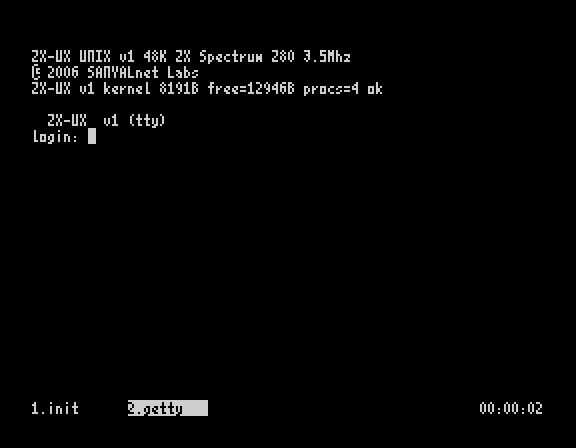
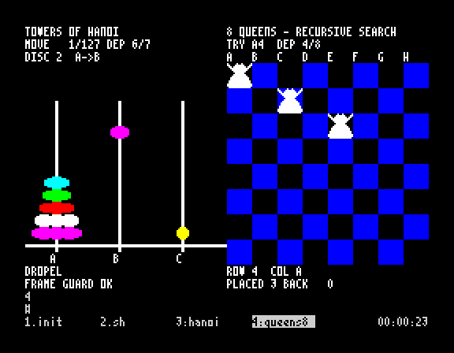
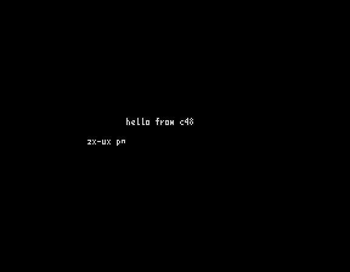
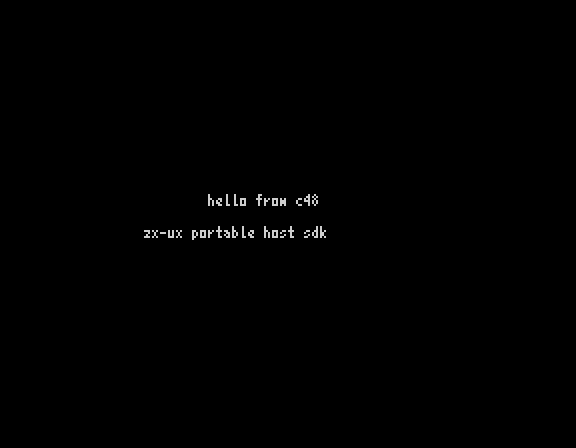
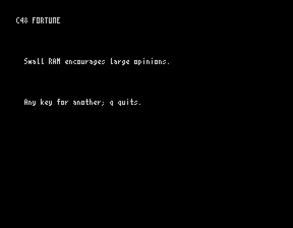
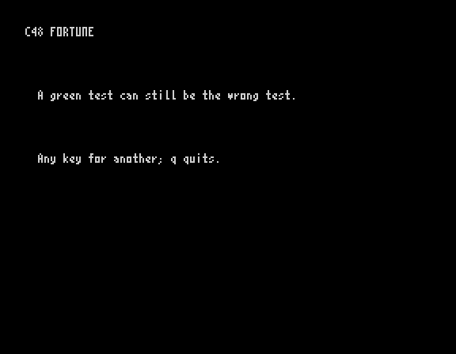
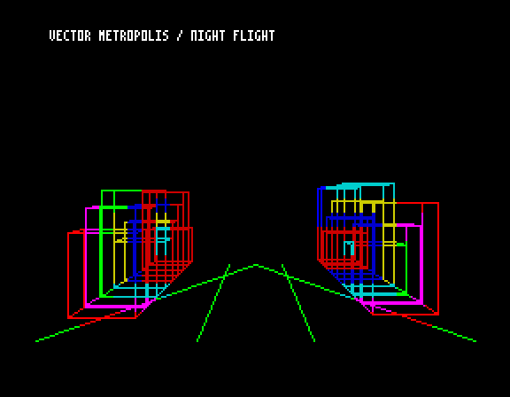
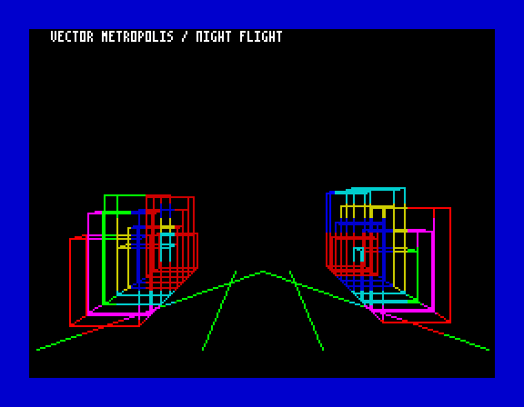
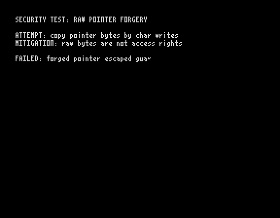
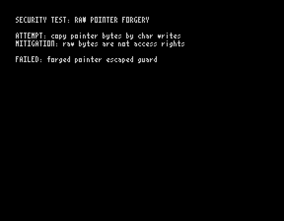

# ZX-UX v1: C48 build and emulator proof

This report records tests run on 10 October 2026 from the checked ZX-UX
source at commit `c78f132331193c3765661655f80691d9b634731d`.
The images are captures from actual emulation or the named host VM.
Every image is labelled with the runtime that produced it.

## System build and boot

- Target: Sinclair ZX Spectrum 48K, using the Spectrum ROM.
- Resident kernel: 8,191 bytes; maximum 8,192 bytes.
- Startup code: 165 bytes; maximum 256 bytes.
- Available program arena at boot: 12,946 bytes.
- Process slots: four.
- The checked source and toolbox passed the private checker.
- The fresh system build and all 12 static boot checks passed.
- The ROM loaded `build/ZX-UX.tzx` and wrote `build/test.z80`.
- All 20 system tests passed, with no failures.
- All 692 assembler comparison instructions matched SJASMPlus 1.24.0.

The core native files are `build/ZX-UX.tzx`, `build/ZX-UX.tap`,
`build/unix.bin`, and `build/fs.img`.



## C48 compilation and execution

The 56 standard programs were compiled from the committed, checked
historical source collection (now preserved separately in `obsolete-sdk/usr/src/`). This includes the repaired programs
`games/fortune.c` and `security/secforge.c`. The two extra multitask
images, `hanoi-mt.ssx` and `queens8-mt.ssx`, were also compiled from
those sources. No standard C48 program was removed or skipped.

All 73 configured C48 sessions passed on the emulated Spectrum.
These include 56 programs and 17 additional test sessions. Tests were
run in four groups: 26 apps/demos, two further demos, 31 games and
scripted game sessions, and 14 examples, security, and sound sessions.
Each session produced a `build/shots/*.ZX-UX.png` capture.

The complete 73-session emulator test was split into groups after a
single long run reached the execution time limit. Each group finished
with no failed cases. This is not a claim that one uninterrupted
73-session command finished.



`build/ZX-UX-multitask.z80` contains a fresh machine snapshot of
Hanoi and Queens8 running at the same time, from the newly compiled
multitask images. The shell still uses the bottom rows. The screenshot
is a capture of that machine state, not a drawing.

## Paired program pictures

Each left image below comes from a real ZX-UX tape-loaded program.
Each right image comes from the ZX-UX SDK host `rvm`, using the same
compiled SSX file. The new pictures matched the previously published
proof images byte-for-byte.

| Program and source | ZX-UX emulator | ZX-UX host VM |
|---|---|---|
| `examples/hello.c` |  |  |
| `games/fortune.c` |  |  |
| `demos/city.c` |  |  |
| `security/secforge.c` |  |  |

These host images are not upstream SDK reference VM images.
An independent upstream SDK comparison was not performed because its
compiler and reference VM were unavailable in the test environment.
Independent FUSE boot testing was also not performed.

## Reproduce the checked work

Run from a clean checkout with SJASMPlus, SkoolKit 10.1, the checked
Spectrum ROM, Pillow, and the private checker stored outside Git.
Use the command-line arguments documented by each tool.

```sh
python3 tools/build.py /path/to/sjasmplus
python3 tests/test_boot_v1.py
python3 sdk/lib/build.py
python3 sdk/tests/test_ras.py
python3 /path/to/tap2sna.py build/ZX-UX.tzx build/test.z80
python3 tests/suite.py
python3 tools/mktapes.py
python3 tests/ssxrun.py --png build/shots
python3 tools/mtsnap.py 500
python3 tools/bootshot.py
python3 tools/c48_proofs.py
```

Some commands require environment variables for the installed tools.
The independent SDK and FUSE checks remain requirements for the full
final release. The tests above cover the build and emulated runs only.
